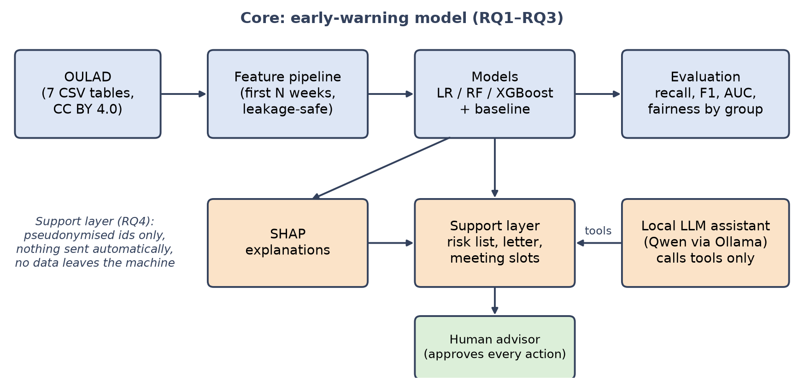
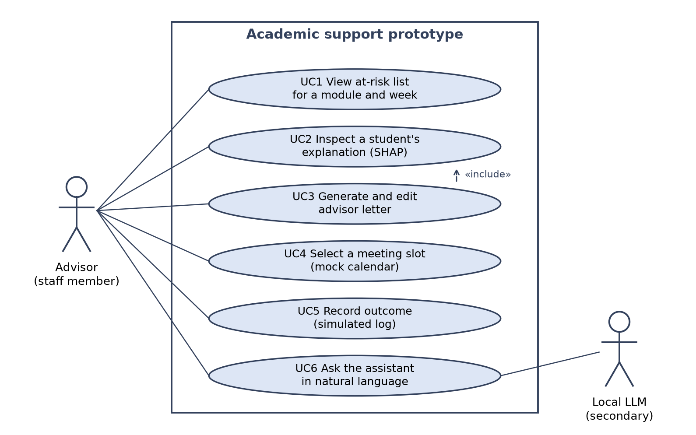
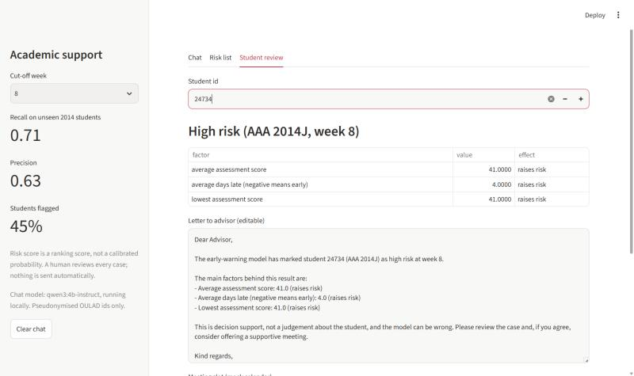
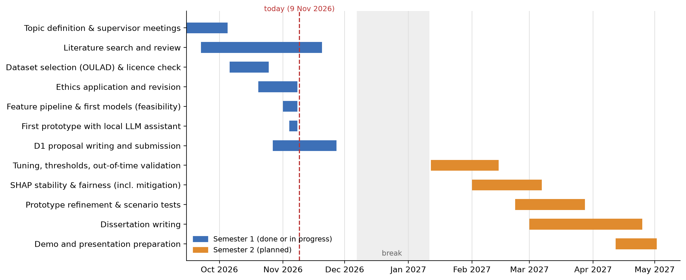
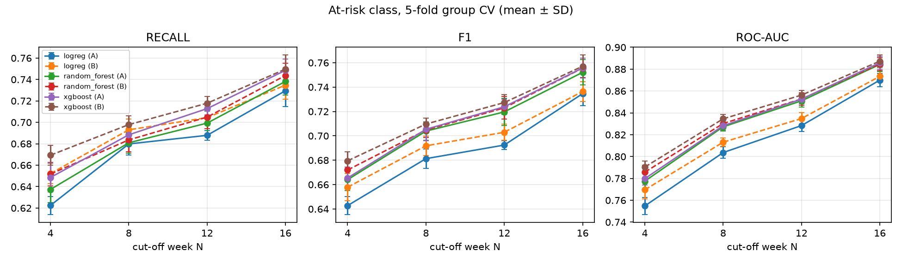
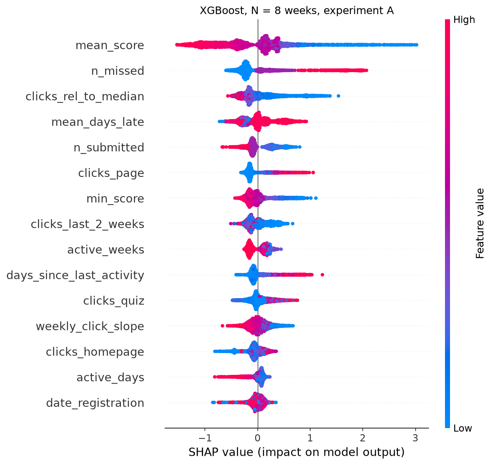
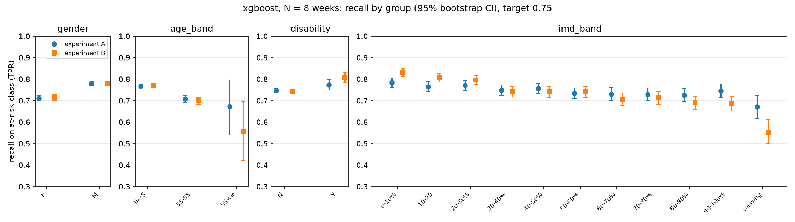
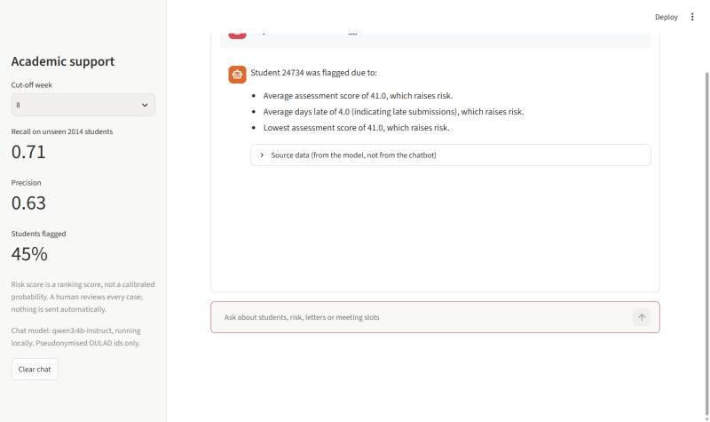

# D1 Project Proposal

**Title:** Development of an AI-Based Student Academic Support System  
**Student:** Darmen Orynbassar (group CE401) · **Supervisor:** Inkar Zhumay  
**Programme:** BSc (Hons) Computational Sciences with Software Engineering · **Course:** F20PA Research Methods & Requirements Engineering  
**Status:** generated from the same text as `D1_Project_Proposal_Darmen_Orynbasar.docx` (the submitted version is the Word/PDF file).

## Abstract

Many students who fail or withdraw from a module show warning signs in the first weeks, but staff rarely have the time or tools to notice them early. The goal of this project is an AI-based academic support system that identifies students at risk of failing or withdrawing from the first *N* weeks of activity and turns each prediction into an explained, human-reviewed action. Using the public Open University Learning Analytics Dataset (OULAD), a leakage-safe pipeline builds features for cut-offs of 4 to 16 weeks, and logistic regression, random forest and XGBoost are compared with a baseline. In first experiments, XGBoost reaches a ROC-AUC of 0.83 at week 8 in student-grouped cross-validation and 0.79 when trained on 2013 and tested on unseen 2014 students. SHAP shows that assessment scores, missed assessments and relative VLE activity drive the predictions, and adding demographic inputs barely improves accuracy but widens gaps between groups. A first prototype combines a risk list, explanations, an editable advisor letter and a local language-model assistant, with a human approving every action. The second semester will tune the models, test fairness mitigation and evaluate the prototype.

## 1. Introduction

### 1.1 Context and Motivation

Student failure and withdrawal are costly for students and for universities. In online and blended learning, staff see students less often, so early warning signs such as fewer logins, late or missing assessments and falling activity are easy to miss. Virtual learning environments (VLEs) record exactly these signals, which makes data-driven early warning possible [1, 2]. However, many predictive models are judged only by accuracy, are hard for educators to interpret, and stop at the prediction without linking it to an action [3, 4]. This project aims to close that gap.

My motivation comes from my own setting. As a final-year student (group CE401) at the Heriot-Watt campus in Aktobe, I study at a young campus where a small number of staff support a growing number of students. I am interested in whether the data that a university already collects could help staff notice a struggling student before a missed deadline turns into a failed module, and in how this can be done without turning students into risk scores.

### 1.2 Aim

The aim of this project is to design, implement and evaluate an AI-based academic support system. Its core is a machine-learning model that identifies students at risk of failing or withdrawing from a module using only the first *N* weeks of their activity. Its support layer turns each prediction into an explained, human-reviewed action: a drafted letter to an advisor, proposed meeting slots and a local assistant that answers an advisor's questions from the model's outputs.

### 1.3 Research Questions and Objectives

- **RQ1.** How accurately can logistic regression, random forest and XGBoost identify at-risk students (Fail or Withdrawn versus Pass or Distinction) from VLE activity, assessment and registration data available in the first *N* weeks of a module presentation?

- **RQ2.** How early can at-risk students be identified reliably, i.e. how do recall, F1 and AUC on the at-risk class change as *N* increases?

- **RQ3.** Which features drive the predictions, and do the models perform consistently across demographic groups (gender, age band, disability and deprivation band)?

- **RQ4.** Can model outputs and explanations be translated into a support workflow that meets defined functional requirements and works on realistic scenarios?

*Table 1. Project objectives and the research questions they address.*

| ID | Objective | RQ |
|---|---|---|
| O1 | Review the literature on AI in academic support, early-warning systems, OULAD-based prediction, explainability, fairness, ethics and conversational AI. | All |
| O2 | Prepare OULAD: clean the data, define the at-risk label and build leakage-safe features for several cut-off weeks. | RQ1, RQ2 |
| O3 | Train and tune logistic regression, random forest and XGBoost against a majority-class baseline. | RQ1 |
| O4 | Evaluate with recall, precision, F1, ROC-AUC and PR-AUC on the at-risk class. Preliminary targets: at-risk recall ≥ 0.75 and ROC-AUC ≥ 0.80 by week 8–12, revised in the light of first results. | RQ1, RQ2 |
| O5 | Explain predictions with SHAP and compare model performance across demographic groups. | RQ3 |
| O6 | Implement a support-layer prototype (risk list, explanation, letter, meeting proposal, local assistant) and test it on OULAD-derived scenarios. | RQ4 |
| O7 | Reflect on professional, legal, ethical and social issues and on the limitations of the findings. | All |

### 1.4 Problems to Be Solved

- **Label and timing:** defining “at risk” so that only information available before the cut-off week is used.

- **Data leakage:** preventing future data, or records of the same student, from leaking between training and test sets.

- **Class imbalance:** at-risk students may be a minority in some modules and cut-offs, so accuracy alone is misleading.

- **Interpretability:** making predictions understandable and actionable for staff.

- **Fairness:** checking that the models do not perform worse for particular groups of students.

- **From prediction to action:** designing a workflow in which humans stay in control of every decision, including when a language model is part of the interface.

### 1.5 Organisation of the Document

Section 2 reviews related work, Section 3 describes the methodology and requirements, Section 4 presents preliminary results and Section 5 concludes. The project plan, risks, PLES, the GenAI summary and supplementary figures are in Appendices A to C.

## 2. Background Research

This section reviews six strands of work that the project builds on: the evidence for AI in academic support, learning analytics and early-warning systems, machine learning for at-risk prediction, studies that use OULAD, interpretability and fairness, and conversational AI for student support. It ends with a comparison of OULAD studies and the research gap. Table 2 summarises the systematic reviews used, because together they show where the evidence is strong and where it is thin.

*Table 2. Systematic reviews and meta-analyses used in this section.*

| Review | Scope | Finding most relevant to this project |
|---|---|---|
| Zawacki-Richter et al. [5] | 146 articles, 2007–2018; AI in higher education | Few studies involve educators or reflect on ethical risks |
| Ma et al. [6]; Steenbergen-Hu and Cooper [7] | Meta-analyses of intelligent tutoring systems | Positive effects, but not better than one-to-one human tutoring |
| Albinali et al. [8] | AI in academic advising | Chatbots, recommenders and predictive analytics; language and ethical barriers |
| Viberg et al. [3] | 252 papers on learning analytics in higher education | Little evidence of improved learning outcomes or wide use in practice |
| Albreiki et al. [9] | EDM studies, 2009–2021; performance, dropout and at-risk prediction | Most use institutional or online-platform data |
| Sekeroglu et al. [10] | Performance prediction, 2010–2020 | Inconsistent datasets, validation and metrics; need for standard evaluation |
| Alalawi et al. [11] | 162 studies, 2010–2022; performance prediction | Classification dominates; very few studies test a remedial action |
| Jin et al. [4] | 17 OULAD studies, 2017–2024 | More interpretability and educational theory needed |
| Badger et al. [12]; An et al. [13] | 49 and 39 studies of GenAI use in higher education | Benefits with risks of over-reliance and integrity problems; guidance needed |

### 2.1 AI in Higher Education and Academic Support

Artificial intelligence is now widely applied in higher education, but the research base is uneven. In a systematic review of 146 articles published between 2007 and 2018, Zawacki-Richter et al. [5] grouped applications into four areas: profiling and prediction, assessment and evaluation, adaptive systems and personalisation, and intelligent tutoring systems (ITS). They found that most studies came from computer science and engineering rather than education, that few were connected to pedagogical theory, and that the studies rarely reflected critically on ethical risks. Their question, “where are the educators?”, is directly relevant to this project: a prediction model that staff cannot understand or act on is unlikely to change anything for students.

The strongest evidence that AI support helps learners comes from ITS. A meta-analysis of 107 effect sizes from 14,321 participants found that learning with an ITS was associated with higher achievement than teacher-led large-group instruction, non-ITS computer-based instruction and textbooks, but did not differ significantly from individualised human tutoring or small-group instruction [6]. For college students specifically, ITS had a moderate positive effect on academic learning and outperformed most other forms of instruction, but were less effective than one-to-one human tutoring [7]. VanLehn [14] compared tutoring types and concluded that step-based tutoring systems come close to the effectiveness of human tutors, while answer-based systems are clearly weaker. Taken together, these meta-analyses suggest that AI can complement, but not replace, human support. The design consequence for this project is a system that flags students and prepares information, while a person decides what to do.

Academic advising is the setting closest to this project. A recent systematic review of AI in advising identified three main roles for AI: chatbots that answer student questions and help with course choices, recommender systems that suggest modules from students' interests, and predictive analytics that forecast grades and identify at-risk students [8]. The authors report gains in efficiency and in how well guidance matches students' goals, but also highlight language barriers and ethical concerns as open problems. This project combines two of these roles, prediction and a conversational interface, and treats the ethical concerns as design requirements rather than as an afterthought.

### 2.2 Learning Analytics and Early-Warning Systems

Learning analytics and educational data mining (EDM) both use data about learners to understand and improve learning. Siemens and Long [1] describe learning analytics as the measurement, analysis and reporting of data about learners and their contexts in order to improve learning and learning environments, and argue that data from VLEs can make the “fog” of large courses more visible to teachers. Baker and Yacef [15] review the early EDM field and identify prediction, clustering, relationship mining, distillation of data for human judgement and discovery with models as its main methods. Early warning of at-risk students is a prediction task, but its value depends on the “distillation for human judgement” step: the output must be something a teacher can use.

Course Signals at Purdue University is the best-known early-alert system. It combined course performance, effort measured through interaction with the learning management system, prior academic history and student characteristics into a traffic-light indicator, and staff used the signals to send feedback and interventions to students; the authors reported improved grades and retention in courses that used it [2]. More recent systems automate the full workflow. LANSE is a cloud-based platform that trains models on learning-management-system logs and gives teachers weekly predictions of dropout and failure risk together with visualisations of student interactions; its authors report practical challenges in privacy compliance, data management, real-time processing and security [16]. Hlosta et al. [17] address a different practical problem: new modules have no historical data to train on. Their Ouroboros approach learns from students in the current presentation who have already submitted the first assessment in order to identify those who are at risk of not submitting it.

The evidence that such systems improve learning is weaker than the evidence that they can predict. In a review of 252 papers on learning analytics in higher education, Viberg et al. [3] found that most studies focused on prediction and on understanding learning, and that there was little evidence of improved learning outcomes or of learning analytics being used widely in practice. Alalawi et al. [11] reach a similar conclusion for performance prediction specifically: among 162 studies published between 2010 and 2022, very few tested a remedial action and measured its effect on students. Two lessons follow for this project. First, the prediction should be linked to a concrete, timely action. Second, the action should be designed so that its effect can be evaluated later, even if a full intervention study is outside the scope of an honours project.

### 2.3 Machine Learning for At-Risk and Dropout Prediction

Several systematic reviews map the machine-learning literature on student performance. Albreiki et al. [9] reviewed EDM studies from 2009 to 2021 on predicting performance and identifying dropouts and at-risk students, and found that most used data from institutional databases or online learning platforms, with growing use of behavioural data. Sekeroglu et al. [10] reviewed studies from 2010 to 2020 and highlighted wide variation in the datasets, models, validation methods and metrics used, which makes results hard to compare; they called for standardised evaluation and validation strategies. Alalawi et al. [11] found classification to be the most common formulation, with ensemble methods and neural networks among the most frequent models.

For tabular behavioural data, logistic regression and tree ensembles are the usual choices. Logistic regression is simple and interpretable and is a strong baseline when features are well designed. Random forests average many decision trees, each grown on a bootstrap sample with a random subset of features, which reduces variance and handles non-linear interactions [18]. XGBoost is a scalable implementation of gradient-boosted trees with regularisation and efficient handling of sparse data, and is widely used for structured data [19]. These three models, compared against a majority-class baseline, cover a range from transparent to more flexible and match the models recommended by the supervisor.

The inputs used in these studies fall into a few groups: previous and current assessment results, activity in the learning platform, submission behaviour, enrolment details and demographics [9, 11]. For early warning, these groups become available at different times. Click data exists from the first day of a module, while assessment results are sparse in the first weeks and become richer as deadlines pass. There is therefore a trade-off between earliness and accuracy: a prediction made in week 4 rests on less evidence but leaves more time to help, while a prediction made in week 16 is more accurate but may come too late. Few studies report results at several cut-off points on the same data, so this trade-off is rarely visible. This motivates RQ2 and the comparison of cut-off weeks in this project.

A second gap concerns how scores become alerts. Most studies report one metric at a default decision threshold, but in a real system the threshold decides how many students are flagged, and therefore how much staff time is needed and how many students who would have passed receive an unnecessary contact. Course Signals used three levels rather than a yes-or-no label [2], and LANSE presents weekly risk to teachers [16], but neither kind of system makes the cost of a chosen threshold explicit in the published results. Choosing the threshold to reach a target recall and reporting the resulting precision and alert volume makes this trade-off visible to the people who must act on it. A related weakness is validation design. Random splits of records allow the same student, or very similar cohorts, to appear on both sides of the split, whereas a deployed model is trained on past cohorts and applied to a new one. Temporal (out-of-time) validation is closer to real use and is one answer to the call for more consistent validation [10]; the difficulty of reusing models trained on legacy data in new modules [17] is a reminder that data from one cohort does not always transfer to the next.

Two methodological issues recur in this literature and directly shape the method in Section 3. The first is class imbalance. When at-risk students are a minority, a model can reach high accuracy by predicting that nobody is at risk. Saito and Rehmsmeier [20] show that precision–recall analysis is more informative than ROC analysis for imbalanced problems, which is why this project reports PR-AUC, recall and precision on the at-risk class. Oversampling methods such as SMOTE create synthetic minority examples by interpolating between neighbours [21]; if they are applied before data is split, synthetic copies of test students leak into training. The second issue is data leakage more generally: using information recorded after the prediction point, or placing records of the same student in both training and test sets, inflates reported results. Many studies do not report how they avoided this, which is one reason why published accuracies vary so much.

### 2.4 Predictive Modelling with OULAD

The Open University Learning Analytics Dataset (OULAD) contains anonymised demographic, registration, assessment and daily VLE click data for 32,593 student registrations on seven modules, across 22 module presentations in 2013 and 2014 [22]. It is released under a CC BY 4.0 licence, and all dates are stored relative to the start of each presentation, which makes it possible to restrict features to the first *N* weeks. Because it is public and documented, OULAD has become a benchmark for learning-analytics research.

Jin et al. [4] systematically reviewed 17 OULAD studies published between 2017 and 2024. They grouped them into three themes: predicting performance, identifying at-risk students and predicting engagement. Decision trees, random forests, support vector machines, logistic regression, gradient boosting and k-nearest neighbours were the most common models, with growing use of deep learning. The review concludes that the field needs more attention to interpretability and to linking models with educational theory. Two deep-learning studies illustrate the range of results. Hassan et al. [23] treat early withdrawal as a sequential classification problem on weekly clickstream data and report that a long short-term memory (LSTM) network reached 97.25% accuracy, 92.79% precision and 85.92% recall, outperforming logistic regression and a feed-forward network. Waheed et al. [24] build features from VLE clickstreams and report 84–93% accuracy for a deep artificial neural network, compared with 79.8–85.6% for logistic regression and 80.0–89.1% for a support vector machine.

These numbers are not directly comparable with each other or with this project. Studies differ in the target (withdrawal only, pass versus fail, or both at-risk outcomes together), in how much of the course is observed before predicting, in whether withdrawn students are excluded, and in whether the same student can appear in both training and test data. A model that sees most of a presentation will score higher than one that predicts in week 4, but it is less useful for early support. Table 3 therefore compares studies by target and timing as well as by headline metric. It shows that high accuracies are usually reported for later or sequence-based predictions, and that student-grouped and out-of-time evaluation is rarely reported.

*Table 3. Comparison of OULAD-based prediction studies (results as reported by the authors; not directly comparable).*

| Study | Target | Data and models | Timing | Reported result |
|---|---|---|---|---|
| Hassan et al. [23] | Withdrawal | Weekly VLE clickstream; LSTM vs LR and ANN | Week-by-week sequence | Accuracy 97.25%, recall 85.92% |
| Waheed et al. [24] | Academic performance | Hand-crafted VLE features; deep ANN vs LR and SVM | Varies by experiment | Accuracy 84–93% (LR 79.8–85.6%) |
| Hlosta et al. [17] | Not submitting the first assessment | Current-presentation data only; no legacy model | Before the first deadline | Works without legacy data; different target |
| This project | Fail or Withdrawn vs Pass or Distinction | VLE, assessment and registration features; LR, RF, XGBoost | *N* = 4, 8, 12, 16 weeks | ROC-AUC 0.83 (week 8, CV); 0.79 on unseen 2014 data |

### 2.5 Interpretability, Fairness and Ethics

Predictions that cannot be explained are hard for educators to trust or act on. SHAP (SHapley Additive exPlanations) assigns each feature an additive contribution to an individual prediction, based on Shapley values from cooperative game theory [25]. Lundberg and Lee show that it unifies several earlier explanation methods and is the only additive attribution that satisfies local accuracy, missingness and consistency. For tree models, contributions can be computed efficiently, so SHAP supports both a global view of which features matter and a student-level view of why one student was flagged. This matches the two audiences of an early-warning system: researchers checking the model and advisors deciding about one student.

Explanations also have limits that matter in practice. SHAP values explain the model, not the student: they show which inputs moved a prediction, not why a student is struggling. When features are correlated, for example total clicks and active days, credit can be shared or shifted between them, so a single factor should not be read as a cause. For advisors this means that explanations should be phrased as what the model noticed, shown together with the underlying values, and treated as a starting point for a conversation. Stability matters as well: if the top factors change between cross-validation folds or retrained models, the explanations are less trustworthy, which is why this project plans to check how stable the most important features are.

Fairness matters because a model can be accurate on average but worse for some groups. Hardt et al. [26] define equalised odds, which requires equal true-positive and false-positive rates across groups, and the weaker criterion of equality of opportunity, which requires only equal true-positive rates. In an early-warning setting, equality of opportunity means that at-risk students in every group have the same chance of being noticed. Cabral et al. [27] compare traditional machine-learning methods for student performance prediction in introductory programming courses and show that models with similar accuracy can differ in fairness, so fairness must be measured rather than assumed. A related design question is whether demographic attributes should be model inputs at all: they may add accuracy, but they also let the model treat students differently because of who they are rather than what they do. This project measures both options (Section 3.3).

Ethical analysis of learning analytics goes beyond metrics. Prinsloo and Slade [28] argue that ethics and privacy should be seen as enabling learning analytics rather than obstructing it, and that institutions have a duty to use the data they hold to support students, transparently and with care. Rubel and Jones [29] raise concerns about intrusive data collection, the power imbalance between institutions and students, and threats to student autonomy. Risk labels can stigmatise students and can become self-fulfilling if staff treat them as facts. These concerns lead to concrete requirements in this project: predictions are framed as decision support, every flag comes with an explanation, a human approves every action, nothing is sent automatically, and only public, anonymised data is used.

### 2.6 Conversational and Generative AI for Student Support

Large language models (LLMs) have made conversational interfaces practical for student support. Özer et al. [30] describe a chatbot for university student services built on retrieval-augmented generation (RAG), in which the model answers from retrieved institutional information rather than from its training data alone. The system was designed after interviews with 20 students, integrated into a student-affairs portal and evaluated by 40 students, who reported improved accuracy, efficiency and satisfaction. Modran et al. [31] present an LLM tutor for university courses that uses RAG over curated course material, built with LlamaIndex on the OpenAI API; this work is a preprint and has not been peer reviewed. Miladi et al. [32] compare GPT models on exercises from a MOOC and find that grounding GPT-4 in course material with RAG clearly improves the accuracy of its answers compared with the model alone.

Reviews of generative AI in higher education show both benefits and risks. Badger et al. [12] review 49 empirical studies from 2022 to 2024 on how GenAI chatbots affect motivation, engagement, self-regulation, comprehension, critical thinking and performance. They report benefits from personalised help and immediate feedback, but also risks of over-reliance, weaker critical thinking and academic-integrity problems, and call for guided, pedagogically sound use. An et al. [13] review 39 studies of how students use GenAI, identify seven types of use and find that measured outcomes were mostly positive, while perceived outcomes varied with the type of use. Both reviews recommend guidance and safeguards rather than unrestricted use.

The way these systems are evaluated also differs. The student-services chatbot was evaluated mainly through students' ratings of response quality, reliability and usability [30], and the tutoring preprint describes a design rather than a controlled evaluation [31]; only the MOOC study measures answer accuracy against reference answers [32]. For a system that reports risk information about individual students, user satisfaction is not enough, because a fluent answer with a wrong number or an overstated claim can mislead an advisor. This points to evaluating an assistant with fixed scenarios whose correct answers are known, in addition to the usual functional tests of the interface.

Three lessons from this literature shape the support layer. First, answers should be grounded in trusted data: in this project the assistant does not retrieve documents but calls tools that return the model's own outputs, so every number comes from the early-warning model, not from the LLM. Second, errors and over-confident statements are a known risk, so the interface shows the source data next to each answer and the assistant is tested on scenarios that check for invented numbers and overstated claims. Third, privacy matters: unlike the cloud services used in the studies above, the assistant runs a small open model locally, so no student data leaves the machine. None of the reviewed studies combines an LLM interface with an evaluated risk model for advisors, which is part of the gap this project addresses.

### 2.7 Research Gap and Contribution

The reviewed work shows that at-risk students can be predicted from VLE and assessment data, including on OULAD [4, 23, 24], but also that most studies concentrate on predictive accuracy and algorithm comparison, rarely use student-grouped or out-of-time evaluation, rarely check fairness, and rarely connect predictions to an action [3, 11]. Explanation methods and fairness criteria are well established [25, 26], and conversational AI is increasingly used for student services [8, 30], but these strands are seldom combined. This project contributes one design that brings them together: (i) a leakage-safe evaluation of how early risk can be detected, including an out-of-time test; (ii) explanations that an advisor can read; (iii) a fairness comparison with and without demographic inputs; and (iv) a human-in-the-loop support workflow, including a local assistant that only reports the model's outputs.

## 3. Methodology and Work Plan

### 3.1 Research Approach

The project combines a quantitative, experimental study (RQ1–RQ3) with a design-and-demonstration component (RQ4). The experimental study uses secondary analysis of OULAD only, with no surveys, interviews or contact with students. The prototype is evaluated through requirements-based and scenario-based testing rather than with human participants, so the work stays within the submitted ethics application. Figure 1 shows the overall design.

*Figure 1. Overall system design. The core pipeline answers RQ1–RQ3; the support layer (RQ4) acts on predictions only after human approval, and the local assistant can only call support-layer tools.*

### 3.2 Data

OULAD is downloaded from the official Figshare record and cited as required by its licence [22]. It consists of seven linked tables (courses, assessments, vle, studentInfo, studentRegistration, studentAssessment and studentVle). The outcome variable final_result takes the values Pass, Distinction, Fail and Withdrawn. Dataset files stay on the student's computer and are excluded from the public code repository.

### 3.3 Problem Definition and Preprocessing

- **Target:** at-risk = 1 for Fail or Withdrawn; at-risk = 0 for Pass or Distinction.

- **Cut-off weeks:** models are built for *N* ∈ {4, 8, 12, 16}; only data dated before day 7*N* is used.

- **Exclusions:** students who unregistered before the cut-off are excluded at that cut-off, because their outcome is already known; the number excluded is reported.

- **Features:** (a) VLE engagement: total clicks, active days and weeks, clicks per activity type, days since last activity, weekly trend and clicks relative to the median student in the same presentation; (b) assessment: submissions, mean and lowest score, lateness, missed assessments; (c) registration: registration timing, previous attempts, studied credits; (d) demographics: gender, age band, disability, region, highest education, deprivation band.

- **Two feature sets:** Experiment A uses groups (a)–(c); Experiment B adds (d). Comparing them measures what demographic inputs add and supports the fairness analysis.

- **Missing values and imbalance:** imputation uses statistics learned from training folds only. Class weighting is used; SMOTE [21] may be tested, but only inside training folds.

### 3.4 Models and Training

A majority-class model is the minimum baseline. Logistic regression (regularised, with standardised inputs) is the interpretable baseline, followed by random forest [18] and XGBoost [19]. The first experiments use fixed, reasonable hyperparameters; in the second semester they are tuned by randomised search inside cross-validation. The implementation uses Python with pandas, scikit-learn [33], XGBoost and SHAP, with code under version control on GitHub.

To avoid leakage, all preprocessing is part of a scikit-learn pipeline fitted on training folds only, and five-fold cross-validation is grouped by student so that the same student never appears in both training and test folds. An additional out-of-time check trains on the 2013 presentations and tests on the 2014 presentations, after removing test students who also appear in the training data.

### 3.5 Evaluation Strategy

- **Primary metrics:** recall on the at-risk class (missing an at-risk student is the costly error), with precision and F1 on that class.

- **Ranking metrics:** ROC-AUC and PR-AUC [20], with confusion matrices at the chosen threshold.

- **Threshold:** chosen to reach a target recall of 0.75 without using the test labels. In cross-validation the threshold for each fold is chosen on the other folds; in the out-of-time test it is chosen on 2013 data only. The resulting precision and share of students flagged (alert volume) are reported.

- **Uncertainty and earliness (RQ2):** mean ± standard deviation across folds, bootstrap 95% confidence intervals, and metrics plotted against *N* for each model.

- **Explainability and fairness (RQ3):** global and local SHAP explanations and stability of the top features; recall, false-positive rate and precision by group, with the true-positive-rate gap as an equality-of-opportunity measure [26], compared between Experiments A and B.

### 3.6 Support-Layer Prototype and Use Cases

For each flagged student, the prototype shows (1) the risk level at the selected week, (2) the three most influential factors in plain language, derived from SHAP, (3) an editable advisor letter generated from a template and (4) proposed meeting slots from a mock staff calendar, using the Experiment A model trained on 2013 and only unseen 2014 students. A local assistant (Qwen3-4B through Ollama) answers advisors' questions in natural language by calling a fixed set of read-only tools (risk list, explanation, letter draft, free slots and model accuracy); it has no tool that can approve, send or record anything. Only pseudonymised OULAD identifiers are used, a human approves every action, and approving only writes a local, simulated log. The interface is built with Streamlit.

**Use cases.** UC1 view the at-risk list for a module and week; UC2 inspect the explanation for a student; UC3 generate and edit an advisor letter; UC4 select a proposed meeting slot; UC5 record the outcome of the action (simulated); UC6 ask the assistant in natural language. Figure 2 shows the use-case diagram.

*Figure 2. UML use-case diagram of the prototype. The advisor is the primary actor; the local language model is a secondary actor that serves UC6.*

### 3.7 Requirements (MoSCoW)

*Table 4. MoSCoW prioritisation of requirements.*

| Priority | Requirements |
|---|---|
| Must | M1 Leakage-safe feature pipeline for each cut-off week · M2 Train and compare LR, RF and XGBoost against a baseline · M3 Report recall, precision, F1, ROC-AUC and PR-AUC per cut-off · M4 Global and individual SHAP explanations · M5 Performance comparison across demographic groups · M6 Prototype with risk list and explanation for flagged students |
| Should | S1 Editable advisor letter generated from a template · S2 Meeting slots proposed from a mock calendar · S3 Threshold tool trading recall against alert volume · S4 Out-of-time validation (2013 → 2014) |
| Could | C1 Local LLM assistant that answers from model outputs only, with human review (scope to be confirmed with the supervisor) · C2 Weekly risk-trend chart per student · C3 Fairness mitigation such as reweighing |
| Won't | W1 Data collection from real students or staff · W2 Automatic messages or decisions without human review · W3 Integration with live university systems · W4 Cloud LLM services |

**Prototype evaluation.** Requirements coverage (traceability to Table 4), unit tests, 10–20 scenario-based tests built from OULAD cases and response-time checks. User studies would need an ethics amendment and are future work.

## 4. Feasibility

The full pipeline of Section 3 and a first prototype have been implemented and run on the complete dataset. All numbers below come from that code and use untuned hyperparameters.

### 4.1 Dataset and Ethics

OULAD was selected as the primary dataset with the supervisor. Its licence (CC BY 4.0) and citation requirements were checked on the official record, and its structure supports cut-off-based features directly [22]. The 32,593 registrations belong to 28,785 unique students, which confirms the need for student-grouped splits. Overall, 37.9% of registrations end in Pass, 9.3% in Distinction, 21.6% in Fail and 31.2% in Withdrawn, and the at-risk share ranges from 29% to 62% between modules. An ethics application for secondary analysis of public, anonymised data was submitted and revised to describe the modelling methods and to cite the dataset, as requested by the supervisor.

### 4.2 Preliminary Results

*Table 5. Preliminary evidence from the first experiments (Experiment A unless stated).*

| Check | Result |
|---|---|
| Rows per table and join keys verified | studentInfo 32,593; studentAssessment 173,912; studentVle 10,655,280; keys match across tables |
| Students kept at N = 8 after exclusions | 26,532 kept, 6,061 excluded; 42.0% at risk |
| Logistic regression, N = 8 (5-fold grouped CV) | Recall 0.68 ± 0.01; F1 0.68; ROC-AUC 0.80 ± 0.01 |
| XGBoost, N = 8 (5-fold grouped CV) | Recall 0.69; F1 0.71; ROC-AUC 0.83 (0.78, 0.85, 0.89 at N = 4, 12, 16) |
| Out-of-time, train 2013 → test 2014, N = 8 | ROC-AUC: LR 0.78, RF 0.80, XGBoost 0.79 |
| Threshold chosen on 2013 for recall 0.75, N = 8 | On 2014: recall 0.71, precision 0.63, 45% flagged |
| Memory and run time | studentVle loads in about 5 s and uses about 170 MB; all 32 model runs take about 4.5 min on a laptop |

All models clearly beat the majority baseline (recall 0, ROC-AUC 0.50), every metric improves as *N* grows (Figure 5 in Appendix C), and XGBoost and random forest are about 0.02–0.03 ROC-AUC above logistic regression. The ROC-AUC target is met from week 8. The recall target is met in cross-validation (recall 0.75 with precision 0.68 at week 8) but not yet over time: with the threshold chosen on 2013 only, recall on 2014 students is 0.71 at week 8 and reaches 0.75 only at weeks 12–16, which makes threshold and model tuning a main task for semester 2.

In the SHAP analysis for XGBoost at week 8, the strongest drivers are mean assessment score, the number of missed assessments, clicks relative to the median student and lateness, which are easy to explain to an advisor. A first fairness check at the recall-0.75 threshold shows lower recall for female than for male students (0.71 versus 0.78) with equal false-positive rates, and the lowest recall for the small group aged 55 or over (0.67, 185 students). Adding demographic inputs (Experiment B) raises ROC-AUC by only 0.005–0.015 but makes the model treat deprivation bands more differently: recall for students with a missing deprivation band falls from 0.67 to 0.55. Experiment A is therefore the preferred model for the prototype, and fairness mitigation (C3) will be tested. Appendix C shows the SHAP and fairness figures.

### 4.3 Evaluation of Tools

*Table 6. Tools chosen and alternatives considered.*

| Need | Chosen | Alternatives | Reason |
|---|---|---|---|
| Data processing | pandas, Parquet | Polars | Familiar; sufficient for 10.7 M click rows with compact data types |
| Models | scikit-learn, XGBoost | LightGBM, PyTorch | Supervisor-recommended models; pipelines prevent leakage |
| Explanations | SHAP | LIME | Additive and consistent; fast for tree models |
| Prototype UI | Streamlit | Flask with HTML | Fast to build; sufficient for a demonstration |
| Local assistant | Qwen3-4B via Ollama | Cloud LLM APIs, larger local models | Runs on a 4 GB laptop GPU; no data leaves the machine; supports tool calling |
| Version control | GitHub (code only) | — | Data excluded, in line with the ethics application |

### 4.4 Prototype and Design Evidence

A working prototype implements UC1–UC6 (Figure 3); a decision is saved only to a local, simulated log. All 11 unit tests pass, including checks that features ignore data after the cut-off, that only unseen 2014 students are shown and that the assistant has no action tools. Of 17 scenario tests of the assistant (tool choice, invented numbers, overstated claims), 14 pass, with a median reply time of about 9 seconds; the failures, such as calling a low-risk student “not at risk”, show why answers are shown next to their source data and every action stays with a human.

*Figure 3. Prototype, Student review screen for a pseudonymised 2014 student at week 8: risk level, SHAP factors and editable advisor letter. A chat screenshot is in Appendix C.*

## 5. Conclusions

This proposal sets out a focused project: an early-warning model for at-risk students built on OULAD, evaluated for accuracy, earliness, explainability and fairness, and connected to a human-in-the-loop support workflow with a local assistant. The literature shows that prediction alone rarely improves outcomes and that explanation, fairness and a concrete action are often missing; this project addresses them together. Preliminary work shows that the plan is feasible: the pipeline and a first prototype run on a laptop, and an untuned XGBoost model reaches ROC-AUC 0.83 at week 8. It also gives an honest warning, since recall on unseen 2014 students is 0.71 at week 8, below the 0.75 target. Semester 2 will tune the models and thresholds, test fairness mitigation and evaluate the prototype (Appendix A).

## References

[1] G. Siemens and P. Long. 2011. Penetrating the fog: Analytics in learning and education. EDUCAUSE Review 46, 5 (2011), 30–40.

[2] K. E. Arnold and M. D. Pistilli. 2012. Course Signals at Purdue: Using learning analytics to increase student success. In Proceedings of the 2nd International Conference on Learning Analytics and Knowledge (LAK '12). ACM, 267–270.

[3] O. Viberg, M. Hatakka, O. Bälter, and A. Mavroudi. 2018. The current landscape of learning analytics in higher education. Computers in Human Behavior 89 (2018), 98–110.

[4] L. Jin, Y. Wang, H. Song, and H.-J. So. 2024. Predictive modelling with the Open University Learning Analytics Dataset (OULAD): A systematic literature review. In Artificial Intelligence in Education. Posters and Late Breaking Results, Workshops and Tutorials, Industry and Innovation Tracks, Practitioners, Doctoral Consortium and Blue Sky (AIED 2024), A. M. Olney et al. (eds.). CCIS 2150. Springer, Cham, 477–484. https://doi.org/10.1007/978-3-031-64315-6_46

[5] O. Zawacki-Richter, V. I. Marín, M. Bond, and F. Gouverneur. 2019. Systematic review of research on artificial intelligence applications in higher education – where are the educators? International Journal of Educational Technology in Higher Education 16, Article 39 (2019). https://doi.org/10.1186/s41239-019-0171-0

[6] W. Ma, O. O. Adesope, J. C. Nesbit, and Q. Liu. 2014. Intelligent tutoring systems and learning outcomes: A meta-analysis. Journal of Educational Psychology 106, 4 (2014), 901–918.

[7] S. Steenbergen-Hu and H. Cooper. 2014. A meta-analysis of the effectiveness of intelligent tutoring systems on college students' academic learning. Journal of Educational Psychology 106, 2 (2014), 331–347.

[8] K. Albinali, N. A. Iahad, A. F. Yusof, and A. Abdulla. 2024. A systematic literature review of the artificial intelligence role in transformative academic advising: A study of AI applications in higher education. International Journal of Academic Research in Business and Social Sciences 14, 12 (2024), 1429–1443. https://hrmars.com/ijarbss/article/view/24100

[9] B. Albreiki, N. Zaki, and H. Alashwal. 2021. A systematic literature review of student' performance prediction using machine learning techniques. Education Sciences 11, 9 (2021), 552. https://doi.org/10.3390/educsci11090552

[10] B. Sekeroglu, R. Abiyev, A. Ilhan, M. Arslan, and J. B. Idoko. 2021. Systematic literature review on machine learning and student performance prediction: Critical gaps and possible remedies. Applied Sciences 11, 22 (2021), 10907. https://doi.org/10.3390/app112210907

[11] K. Alalawi, R. Athauda, and R. Chiong. 2023. Contextualizing the current state of research on the use of machine learning for student performance prediction: A systematic literature review. Engineering Reports 5, 12 (2023), e12699. https://doi.org/10.1002/eng2.12699

[12] M. Badger, N. López, and C. F. R. Nissen. 2026. The impact of GenAI chatbots on student learning in higher education: A literature review. International Journal of Technology in Education 9, 1 (2026), 43–69. https://doi.org/10.46328/ijte.5111

[13] Q. An, J. H. L. Koh, and Q. Liu. 2026. Generative artificial intelligence in higher education: A systematic review of student use and learning outcomes. Australasian Journal of Educational Technology 42, 3 (2026), 62–82. https://doi.org/10.14742/ajet.10561

[14] K. VanLehn. 2011. The relative effectiveness of human tutoring, intelligent tutoring systems, and other tutoring systems. Educational Psychologist 46, 4 (2011), 197–221.

[15] R. S. Baker and K. Yacef. 2009. The state of educational data mining in 2009: A review and future visions. Journal of Educational Data Mining 1, 1 (2009), 3–17.

[16] C. Cechinel, E. M. Queiroga, T. T. Primo, H. Lemos dos Santos, V. F. C. Ramos, R. Munoz, R. Ferreira Mello, and M. F. B. Machado. 2024. LANSE: A cloud-powered learning analytics platform for the automated identification of students at risk in learning management systems. In Artificial Intelligence in Education. Posters and Late Breaking Results, Workshops and Tutorials, Industry and Innovation Tracks, Practitioners, Doctoral Consortium and Blue Sky (AIED 2024), A. M. Olney et al. (eds.). CCIS 2150. Springer, Cham, 127–138. https://doi.org/10.1007/978-3-031-64315-6_10

[17] M. Hlosta, Z. Zdrahal, and J. Zendulka. 2017. Ouroboros: Early identification of at-risk students without models based on legacy data. In Proceedings of the 7th International Learning Analytics & Knowledge Conference (LAK '17). ACM, 6–15.

[18] L. Breiman. 2001. Random forests. Machine Learning 45, 1 (2001), 5–32.

[19] T. Chen and C. Guestrin. 2016. XGBoost: A scalable tree boosting system. In Proceedings of the 22nd ACM SIGKDD International Conference on Knowledge Discovery and Data Mining (KDD '16). ACM, 785–794.

[20] T. Saito and M. Rehmsmeier. 2015. The precision-recall plot is more informative than the ROC plot when evaluating binary classifiers on imbalanced datasets. PLoS ONE 10, 3 (2015), e0118432.

[21] N. V. Chawla, K. W. Bowyer, L. O. Hall, and W. P. Kegelmeyer. 2002. SMOTE: Synthetic minority over-sampling technique. Journal of Artificial Intelligence Research 16 (2002), 321–357.

[22] J. Kuzilek, M. Hlosta, and Z. Zdrahal. 2017. Open University Learning Analytics dataset. Scientific Data 4 (2017), 170171. https://doi.org/10.1038/sdata.2017.171

[23] S.-U. Hassan, H. Waheed, N. R. Aljohani, M. Ali, S. Ventura, and F. Herrera. 2019. Virtual learning environment to predict withdrawal by leveraging deep learning. International Journal of Intelligent Systems 34, 8 (2019), 1935–1952. https://doi.org/10.1002/int.22129

[24] H. Waheed, S.-U. Hassan, N. R. Aljohani, J. Hardman, S. Alelyani, and R. Nawaz. 2020. Predicting academic performance of students from VLE big data using deep learning models. Computers in Human Behavior 104 (2020), 106189. https://doi.org/10.1016/j.chb.2019.106189

[25] S. M. Lundberg and S.-I. Lee. 2017. A unified approach to interpreting model predictions. In Advances in Neural Information Processing Systems 30 (NeurIPS 2017). 4765–4774.

[26] M. Hardt, E. Price, and N. Srebro. 2016. Equality of opportunity in supervised learning. In Advances in Neural Information Processing Systems 29 (NeurIPS 2016). 3315–3323.

[27] L. de S. Cabral, F. D. Pereira, and R. Ferreira Mello. 2024. Enhancing algorithmic fairness in student performance prediction through unbiased and equitable machine learning models. In Artificial Intelligence in Education. Posters and Late Breaking Results, Workshops and Tutorials, Industry and Innovation Tracks, Practitioners, Doctoral Consortium and Blue Sky (AIED 2024), A. M. Olney et al. (eds.). CCIS 2150. Springer, Cham, 418–426. https://doi.org/10.1007/978-3-031-64315-6_39

[28] P. Prinsloo and S. Slade. 2017. Ethics and learning analytics: Charting the (un)charted. In Handbook of Learning Analytics, C. Lang, G. Siemens, A. Wise, and D. Gašević (eds.). Society for Learning Analytics Research (SoLAR), 49–57. https://doi.org/10.18608/hla17.004

[29] A. Rubel and K. M. L. Jones. 2016. Student privacy in learning analytics: An information ethics perspective. The Information Society 32, 2 (2016), 143–159.

[30] M. F. Özer, M. T. Akpınar, and S. Ceyhan. 2026. Digital student services: Intelligent chatbot systems supported by artificial intelligence and RAG model. Journal of Entrepreneurship and Innovation Management 15, 1 (2026), 272–287. https://dergipark.org.tr/en/pub/jeim/article/1940101

[31] H. A. Modran, I. C. Bogdan, D. Ursuțiu, C. Samoilă, and P. L. Modran. 2024. LLM intelligent agent tutoring in higher education courses using a RAG approach. Preprints (2024), not peer reviewed. https://doi.org/10.20944/preprints202407.0519.v1

[32] F. Miladi, V. Psyché, and D. Lemire. 2024. Leveraging GPT-4 for accuracy in education: A comparative study on retrieval-augmented generation in MOOCs. In Artificial Intelligence in Education. Posters and Late Breaking Results, Workshops and Tutorials, Industry and Innovation Tracks, Practitioners, Doctoral Consortium and Blue Sky (AIED 2024), A. M. Olney et al. (eds.). CCIS 2150. Springer, Cham, 427–434. https://doi.org/10.1007/978-3-031-64315-6_40

[33] F. Pedregosa, G. Varoquaux, A. Gramfort, V. Michel, B. Thirion, O. Grisel, et al. 2011. Scikit-learn: Machine learning in Python. Journal of Machine Learning Research 12 (2011), 2825–2830.

[34] BCS, The Chartered Institute for IT. 2022. BCS Code of Conduct. BCS, Swindon, UK. Retrieved from https://www.bcs.org

[35] UK Parliament. 2018. Data Protection Act 2018 (c. 12). https://www.legislation.gov.uk/ukpga/2018/12

[36] Republic of Kazakhstan. 2013. Law No. 94-V “On Personal Data and Their Protection” (21 May 2013, as amended).

## Appendix A. Project Management

### A.1 Gantt Chart

Figure 4 shows the work completed in the first semester and the plan for the second semester. Work planned for later (pipeline, first models and prototype) was started early to show feasibility, which frees time in semester 2 for tuning, fairness mitigation and evaluation. Dates are indicative and are reviewed at each supervisor meeting.

*Figure 4. Project plan. Blue: semester 1 (done or in progress); orange: semester 2 (planned).*

### A.2 Risk Analysis

*Table 7. Risks and mitigation plans.*

| Risk | Likelihood | Impact | Mitigation |
|---|---|---|---|
| Data leakage inflates results | Medium | High | Cut-off-only features, pipelines fitted in training folds, grouped splits, out-of-time test, unit tests |
| Models do not reach the targets over time | High | Medium | Targets are provisional; tuning and threshold work; results reported honestly (recall 0.71 on 2014 at week 8) |
| Class imbalance distorts metrics | Medium | Medium | Recall, F1 and PR-AUC; class weights; SMOTE only inside folds |
| Biased performance across groups | Medium | High | Fairness analysis, Experiment A vs B, mitigation (C3), documented limitations |
| LLM assistant gives wrong or overstated answers | Medium | Medium | Numbers only from tools; source data shown; scenario tests; human approves every action |
| Ethics scope of the LLM assistant not confirmed | Medium | High | Local model only; confirm with supervisor; the assistant can be switched off without affecting M1–M6 |
| Scope creep (prototype, LLM features) | High | Medium | MoSCoW; Must requirements first |
| Time pressure from other courses | High | Medium | Weekly plan, regular supervisor meetings, buffer weeks |
| Loss of code or work | Low | High | GitHub, frequent commits, local backups |
| Change of ethics scope (e.g. user study) | Low | High | Keep user studies as future work or apply for an amendment first |

### A.3 Professional, Legal, Ethical and Social Issues

**Professional.** The project follows the BCS Code of Conduct [34]: acting in the public interest, working within professional competence and reporting results honestly, including limitations and negative results such as the lower out-of-time recall. Code is version-controlled and tested so that experiments can be reproduced.

**Legal.** OULAD is anonymised and licensed under CC BY 4.0, which requires attribution [22]; dataset files and trained models are not redistributed in the public code repository. Data-protection principles of the UK Data Protection Act 2018 and UK GDPR [35] are respected through data minimisation and no attempt at re-identification. Because the work is carried out at the Aktobe campus, the Kazakhstan Law on Personal Data and Their Protection [36] is also considered, although no personal data is collected. Open-source libraries and the Qwen model are used under their licences.

**Ethical.** Risk labels can stigmatise students, so predictions are framed as decision support, not decisions; explanations accompany every flag; a human approves every action and nothing is sent; and performance is checked across demographic groups, with demographic inputs excluded from the prototype model. The local assistant processes pseudonymised, derived data only on the student's computer; whether this use is covered by the ethics application will be confirmed with the supervisor. Ethics approval is sought from Heriot-Watt University for secondary analysis of public data.

**Social.** Early warning could widen access to timely support, but it also raises concerns about surveillance and over-reliance on automated judgements [28, 29]. The data comes from one UK distance-learning university in 2013–2014, so results may not generalise to other institutions, to campus-based study or to current student behaviour; this is stated as a limitation.

## Appendix B. GenAI Summary

- **Tools used:** Claude (Anthropic), through the Claude Code application; ChatGPT (OpenAI); and, inside the prototype, the open Qwen3-4B model run locally through Ollama.

- **Literature and writing:** finding and summarising candidate literature; checking citation details against publisher pages; drafting and restructuring sections of this proposal, including the literature review and abstract, which I checked against the sources and edited.

- **Code and results:** Claude wrote and ran the Python code for the feature pipeline, models, evaluation, fairness analysis, figures and prototype under my direction, on my own computer. All results in this proposal come from that code, which is in the project repository and can be re-run.

- **Data:** while running the code, Claude processed OULAD files on my computer and saw aggregate results and some pseudonymised student records; no dataset files were uploaded to the repository. The local Qwen model receives only derived, pseudonymised model outputs and does not send data anywhere.

- **My role:** I chose the topic, research questions, dataset and methods with my supervisor, reviewed the code, results and text, and am responsible for all decisions and for the final submission.

## Appendix C. Supplementary Material

Figure 5, Figure 6 and Figure 7 support the results in Section 4.2, and Figure 8 shows the assistant answering a question with its source data available below the answer.

*Figure 5. At-risk class metrics against cut-off week (5-fold grouped cross-validation, mean ± SD).*

*Figure 6. SHAP summary for XGBoost at week 8 (Experiment A, model trained on 2013).*

*Figure 7. Recall on the at-risk class by group at week 8, with 95% bootstrap confidence intervals (XGBoost, Experiments A and B).*

*Figure 8. Prototype chat with the local assistant (Qwen3-4B). The expandable “Source data” panel shows the tool output behind the answer.*
